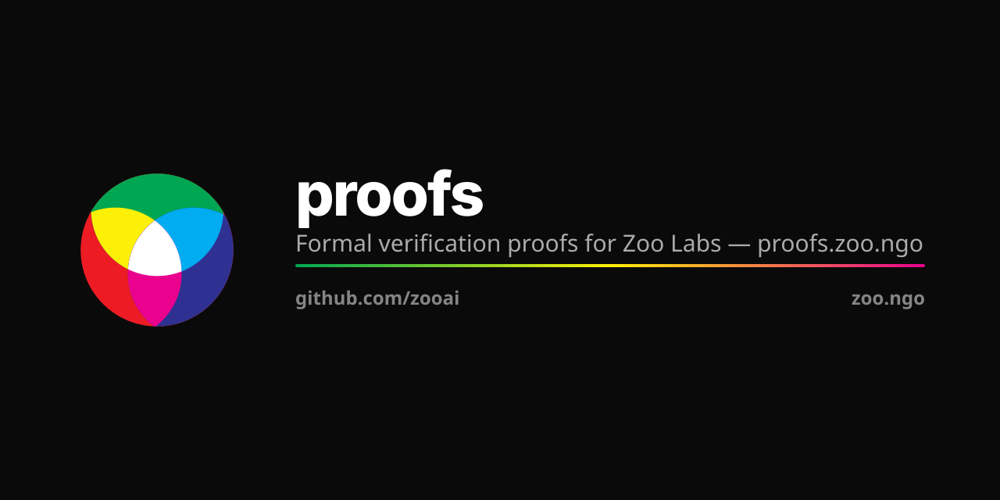

<p align="center"></p>

# Zoo Formal Proofs

Machine-checked and paper proofs for the Zoo Labs Foundation stack:
per-LLM training chains, the original 2021 Zoo NFT protocol, and
homomorphic-DAO governance.

## Provenance

- 2021-10: Zoo whitepaper (Worring & Kelling) coined "NFT Liquidity Protocol"
  for collateral-backed NFT lending. See `~/work/zoo/papers/zoo-2021-original-whitepaper/`.
- 2025: Zoo Securities & DAO paper.
  See `~/work/zoo/papers/zoo-2025-securities-and-dao/`.

## Inventory

| File | Topic | Status |
|---|---|---|
| `zoo-per-llm-chain-soundness.tex` | per-LLM training chain: deterministic gradient ordering, attribution, reproducibility | paper |
| `zoo-dao-governance-soundness.tex` | Homomorphic / holographic-consensus DAO: weighted voting, FHE-tallied secrecy, anti-Sybil | paper |
| `thinking-chains-soundness.tex` | Thinking Chains (Proof of AI): red-team audit of Tier-0 governance contracts + issuance + visibility; on-chain invariants (cap, receipt-auth, digest domain-sep), findings, economic-security caveats | paper |
| `lean/` | Lean 4 sources (shared with `luxfi/proofs/lean/`) | typecheck |

## Build

```bash
cd lean && lake build
tectonic zoo-per-llm-chain-soundness.tex
tectonic zoo-dao-governance-soundness.tex
```

## ZIP cross-references

See `~/work/zoo/zips/INDEX.md` "Formal Proofs" section.

| ZIP | Proof |
|---|---|
| ZIP-0400-0418 (AI Assistant + per-LLM chains) | `zoo-per-llm-chain-soundness.tex` |
| ZIP-0500-0570 (Sustainability + DAO) | `zoo-dao-governance-soundness.tex` |

## Chronology

See `CHRONOLOGY.md`.
